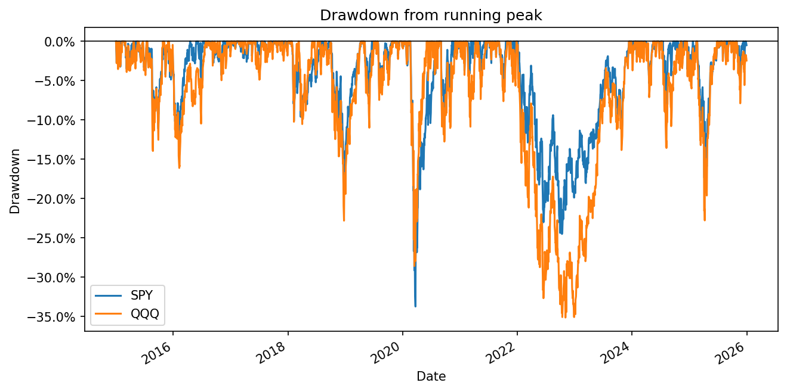

# quant-research
Python tools and studies in quantitative finance: return, risk and drawdown analytics, with backtests to come.

## Contents
**Modules:** [`data.py`](data.py) loads prices · [`drawdown.py`](drawdown.py) measures drawdowns

## drawdown_stats
Takes a date-indexed series of prices (a pandas Series or one-column DataFrame) and returns the max drawdown, the bottom date, and the recovery date (`None` if the price hasn't regained its prior peak).

```python
from data import load_prices
from drawdown import drawdown_stats

prices = load_prices("SPY", "2015-01-01", "2025-12-31")
max_dd, bottom, recovered = drawdown_stats(prices)
```

### Results
Daily dividend-adjusted closes from yfinance, 2015–2025.

| Ticker | Max drawdown | Bottom | Recovered |
|---|---|---|---|
| SPY | −33.7% | 2020-03-23 | 2020-08-10 |
| QQQ | −35.1% | 2022-11-03 | 2023-12-13 |

### Drawdowns over time


## load_prices
Downloads daily adjusted closing prices from Yahoo Finance and returns a DataFrame with one column per ticker, aligned by date. Accepts a single ticker or a list; tickers with no data are dropped with a warning.

```python
from data import load_prices

prices = load_prices(["SPY", "QQQ"], "2015-01-01", "2025-12-31")
```

Downloads are cached as CSV files in `data_cache/` (one per ticker and date range) and reused on later calls. Pass `refresh=True` to download again, for example after Yahoo revises its data or a new dividend changes the adjusted history. The cache folder is not committed to the repository.

**Limitation:** Yahoo Finance has no history for delisted companies, so a backtest on today's stocks only includes the survivors. Results will look better than a strategy could have achieved in real time.
