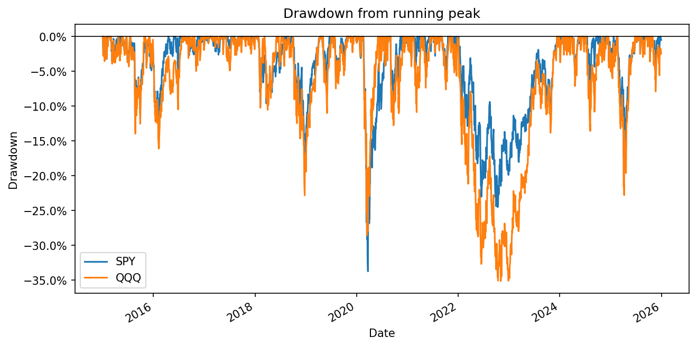

# quant-research
Python tools and studies in quantitative finance: return, risk and drawdown analytics, with backtests to come.

## drawdown_stats
Takes a date-indexed series of prices (a pandas Series or one-column DataFrame) and returns the max drawdown, the bottom date, and the recovery date (`None` if the price hasn't regained its prior peak).

```python
import yfinance as yf
from drawdown import drawdown_stats

prices = yf.download("SPY", start="2015-01-01", end="2025-12-31")["Close"]
max_dd, bottom, recovered = drawdown_stats(prices)
```

### Results
Daily dividend-adjusted closes from yfinance, 2015–2025.

| Ticker | Max drawdown | Bottom | Recovered |
|---|---|---|---|
| SPY | −33.7% | 2020-03-23 | 2020-08-10 |
| QQQ | −35.1% | 2022-11-03 | 2023-12-13 |

### Drawdowns over time

